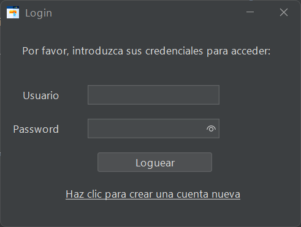
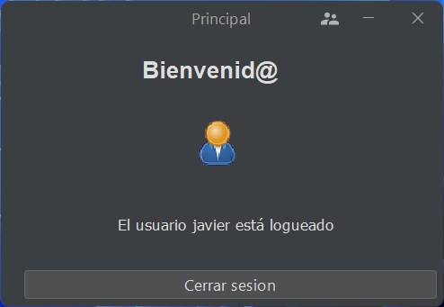
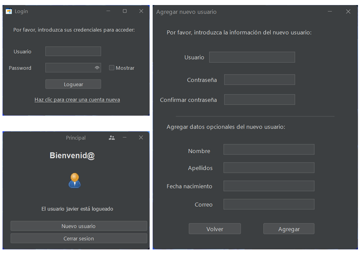

# Práctica 3.1 Login, registro de usuarios y conexión a Aiven

Diseña una aplicación Java Swing que permita crear una cuenta, iniciar sesión y cerrar sesión. Aplicarás los criterios de usabilidad de la **UT3.1** y la conexión mediante JDBC de la **UT3.2**, utilizando **MySQL en Aiven**.

Continuarás con lo trabajado previamente: separación entre interfaz y lógica, Maven, FlatLaf, pruebas con **JUnit 4** y **AssertJ Swing**, documentación y uso de ramas.

## Preparación del proyecto

Crea un proyecto Maven de Apache NetBeans llamado `practica3-1` dentro de `SOL` del repositorio. Organiza las clases en los dos paquetes utilizados anteriormente:

```text
Modelo
VistaControlador
```

Mantendremos esta separación básica; no se exige dividir la vista y el controlador en paquetes independientes.

Utiliza las ramas `parte-1`, `parte-2` y `parte-3`. Realiza commits descriptivos e integra cada parte comprobada en `main`. Registra en Issues los errores que encuentres durante las pruebas y referencia su corrección en los commits.

Añade mediante Maven las dependencias de FlatLaf, MySQL Connector/J y, con ámbito `test`, JUnit 4 y AssertJ Swing compatibles con lo utilizado en la práctica 2.4. No mezcles las anotaciones de JUnit 4 con las de JUnit Jupiter.


## Parte 1 Login con datos de prueba

Crea mediante el editor visual de NetBeans una ventana **login** sencilla que solicite el nombre de un usuario y su contraseña:

- Usuario: `JTextField` y Contraseña: `JPasswordField`.
- Casilla **Mostrar contraseña** o que use la propiedad `showRevealButton` desmarcados inicialmente.
- Botón **Iniciar sesión**.
- Enlace a **Crear cuenta**, cuya funcionalidad completarás en la parte 2.
- Una zona para mensajes de estado o validación.

Configura *FlatLaf* antes de crear las ventanas y añade un título e **icono** propio a la aplicación.

Si las credenciales son correctas, se abrirá una **ventana principal** que muestre el nombre del usuario y un botón **Cerrar sesión**. Evita dejar ventanas de login duplicadas. Al cerrar sesión, elimina la sesión y vuelve al login con la contraseña vacía y oculta.

### Usabilidad básica

- Asocia etiquetas claras a los campos y establece un orden de tabulación lógico.
- Permite iniciar sesión con el botón y con la tecla Intro.
- Añade ayudas breves cuando aporten información; las etiquetas deben seguir siendo comprensibles sin depender del tooltip.
- No comuniques los errores únicamente mediante el color: añade texto.
- Comprueba legibilidad, distribución y navegación con teclado.

 

## Parte 2 Registro y persistencia en MySQL mediante Aiven

Amplía el ejercicio anterior agregando un acceso a una **Base de Datos relacional** sencilla que conectes mediante JDBC, y que contenga el nombre de los usuarios y sus contraseñas para realizar dicha verificación:

### Preparar la conexión en Aiven

Utiliza un servicio **MySQL de Aiven** del entorno de prácticas. Sigue la preparación guiada de la UT3.2 para:

1. Disponer del servicio y de una base de datos de prácticas llamada `usuarios`.
2. Obten el **host y puerto reales** del servicio. 
3. Incorpora *MySQL Connector/J* al proyecto mediante Maven.
4. Se recomienda crear una clase de pruebas sencilla para probar la conexión y una consulta sencilla antes de integrarlo en la aplicación.

En esta primera práctica utilizaremos la **conexión JDBC básica**, sin configurar opciones TLS ni verificar expresamente la identidad del servidor.

### Organización de la lógica

Debes de utilizar la distribución *Modelo-VistaControlador*, y utilizar esta distribución orientativa dentro de los paquetes existentes:

| Clases | Responsabilidad |
|---|---|
| `Usuario` | Representar los datos del usuario. |
| `ConexionBD` | Leer la configuración y abrir conexiones de BBDD. |
| `UsuarioDAO` | Comprobar o insertar usuarios mediante JDBC. |

Las ventanas en *VistaControlador* recogerán datos, responderán a eventos y presentarán resultados. El *Modelo* no mostrará `JOptionPane` ni accederá a componentes gráficos.

Utiliza `PreparedStatement` para las consultas con datos del formulario y `try-with-resources` para cerrar conexiones, sentencias y resultados.

### Ventana crear cuenta

Desde **Crear cuenta**, se debe abrir una ventana para el registro de nuevos usuarios. 

En dicha ventana deberá requerirse la siguiente información:
-  **Nombre de usuario** y **contraseña**. Campos obligatorios y que **deberán validarse**.
-  Información **opcional**: nombre, apellidos, fecha de nacimiento y correo electrónico. Estos campos por el momento **no deberán validarse**.

Para los campos que deben validarse:
- El usuario tendrá entre 3 y 30 caracteres y admitirá letras ASCII, números y guion bajo. Guarda el identificador sin espacios exteriores y en minúsculas, para que `Alumno1` y `alumno1` sean la misma cuenta.
- La contraseña tendrá al menos 8 caracteres y deberá coincidir exactamente con su repetición.
- No se podrá registrar un nombre de usuario ya existente.  

No te olvides también de aplicar aquí **criterios de usabilidad**: campos claros, mensajes de ayuda y *Tooltips*, validaciones visuales (por ejemplo, colores o mensajes en línea de los campos).



### Empaquetado

Configura `maven-assembly-plugin` en el `pom.xml` para generar un JAR ejecutable con las dependencias y la clase principal. 

Desde NetBeans utiliza **Clean and Build**, comprueba `BUILD SUCCESS` y ejecuta el JAR desde una terminal. 

## Parte 3. Pruebas y documentación

### Pruebas unitarias con JUnit 4

Crea las clases de prueba en `Test Packages`, correspondientes a `src/test/java`. Estas pruebas se ejecutarán sin abrir ventanas ni conectarse a Internet.

Implementa, como mínimo, cuatro casos independientes sobre la lógica de validación:

1. Usuario vacío o formado solo por espacios: rechazado.
2. Usuario válido con espacios exteriores y mayúsculas: normalizado correctamente.
3. Contraseña de menos de 8 caracteres: rechazada en el registro.
4. Contraseña y repetición diferentes: registro rechazado.

Incluye entradas válidas e inválidas. Utiliza aserciones; imprimir un resultado en consola no comprueba automáticamente el comportamiento.

En JUnit 4 utiliza `org.junit.Test`, `org.junit.Before` y `org.junit.After` cuando proceda, y métodos de prueba `public void`. Mantén las dependencias de pruebas con ámbito `test`.

### Comprobaciones de integración y pruebas manuales

Las pruebas anteriores no demuestran que JDBC funcione. Comprueba también el recorrido real contra Aiven: registrar una cuenta ficticia, cerrar la aplicación, volver a abrirla e iniciar sesión con esa cuenta.

Crea `TEST/casos-prueba.md` y completa esta tabla con el resultado real, la fecha y una referencia a la evidencia. Los casos de integración pueden realizarse manualmente; su automatización es una ampliación opcional.

| ID | Caso de prueba | Entrada / Acción | Resultado esperado | Resultado |
|---|---|---|---|---|
| U01–U04 | Validaciones unitarias | Ejecutar los cuatro casos indicados | Todas las aserciones pasan sin Aiven | Pendiente |
| G01 | Login vacío | Ejecutar el caso de AssertJ Swing | Mensaje y foco correctos; no se abre la principal | Pendiente |
| I01 | Conexión JDBC | Ejecutar `SELECT 1` con la URL y credenciales de Aiven | La consulta devuelve 1 | Pendiente |
| I02 | Persistencia y login | Registrar una cuenta ficticia y reiniciar la aplicación | La cuenta persiste y permite entrar | Pendiente |
| I03 | Credenciales incorrectas | Contraseña errónea o usuario inexistente | Mensaje de credenciales incorrectas; permite reintentar | Pendiente |
| I04 | Usuario duplicado | Registrar dos veces el mismo identificador, cambiando mayúsculas | No se crea un segundo registro | Pendiente |
| I05 | Error de conexión | Usar temporalmente una configuración de prueba con puerto incorrecto | Muestra un mensaje comprensible cuando falla la conexión | Pendiente |
| M01 | Mostrar contraseña | Marcar y desmarcar la casilla | Alterna visibilidad; inicialmente está oculta | Pendiente |
| M02 | Registro y opcionales | Abrir registro y dejar vacíos los opcionales | Se muestran los campos y el registro válido puede completarse | Pendiente |
| M03 | Navegación y mensajes | Utilizar Tab e Intro; provocar errores | Orden lógico, foco útil, ayudas y errores comprensibles | Pendiente |
| M04 | Sesión | Entrar y cerrar sesión | Saludo correcto, sin ventanas duplicadas; vuelve al login limpio | Pendiente |
| M05 | Aplicación distribuida | Ejecutar el JAR fuera de NetBeans con su configuración | Icono, dependencias y acceso a Aiven funcionan | Pendiente |

### Documentación y entrega

En `docs/index.md` incluye descripción, funcionalidades, capturas, responsabilidades de los paquetes, preparación de Aiven, nombres de las tres variables de entorno —sin sus valores secretos—, ejecución del JAR y ejecución de pruebas. Documenta con Javadoc las clases principales del modelo y al menos dos de sus métodos.

Añade al README un enlace a la documentación y al informe de pruebas. Si mantienes GitHub Pages de las prácticas previas, comprueba su publicación.

Antes de entregar:

- [ ] Maven, FlatLaf y los paquetes siguen la organización trabajada.
- [ ] Login, registro y cierre de sesión funcionan con MySQL de Aiven.
- [ ] La conexión utiliza el host y puerto reales de Aiven y las credenciales configuradas.
- [ ] Los datos de conexión están centralizados en las variables de clase de `ConexionBD`.
- [ ] La versión publicada del código, las capturas y la documentación utilizan valores de ejemplo para las credenciales.
- [ ] Se validan los obligatorios, se admiten opcionales vacíos y se evitan duplicados.
- [ ] Las conexiones, sentencias y resultados JDBC se cierran correctamente.
- [ ] Pasan los cuatro casos unitarios y al menos un caso de AssertJ Swing.
- [ ] Se han ejecutado y documentado las comprobaciones reales con Aiven.
- [ ] Se ha realizado la revisión de usabilidad y registrado sus conclusiones.
- [ ] El JAR se ejecuta fuera de NetBeans y la documentación permite reproducirlo.
- [ ] Las ramas están integradas en `main` y las incidencias quedan identificadas.


